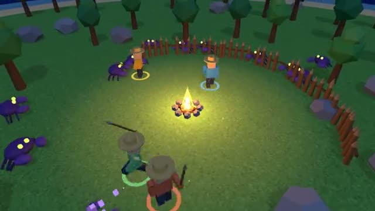

# Island Survive

Chop, build a fire, and last the night together. A multiplayer starter game from [Multiplayer Agent](https://multiplayeragent.com): 3D, co-op, 1–6 players, with bots that help when you play alone.

## How it plays

By day you chop trees, mine rocks and craft an axe, a pickaxe and a spear. At night crabs crawl out of the sea, so keep the campfire fed with wood and fence the camp in: firelight burns them.

**Controls:** WASD and mouse, hold click to chop, mine, fight and feed the fire, 1 to 5 to craft, or the thumb stick and USE button.

## Make it yours in the Game Builder

Open the [Game Builder](https://multiplayeragent.com), choose **Start from a starter game** and pick Island Survive. It opens as version 1 in your studio, ready to play and publish. Then ask for changes, for example:

- Add berry bushes that heal you when you eat them
- Add a giant boss crab every fifth night
- Let players build a raft and sail to a second island

## Run it yourself

1. Get a free publishable key (`pk_…`) at [multiplayeragent.com](https://multiplayeragent.com).
2. In `index.html`, put it in place of `pk_REPLACE_ME` in the `MP_CONNECT` block.
3. Serve the folder (for example `npx serve`) and open it. The 3D engine loads as a module, which browsers block from a file on disk.

Without a key it still runs, offline with bots, and remembers your camp in this browser.

## How it is built

- One `index.html` plus three.js in `libs/`. The comment at the top of the script maps the code and explains the multiplayer.
- **World memory:** The camp is remembered by the players who built it. Every player saves a copy every 10 seconds and when they leave; whoever comes back first brings back its fires, fences and day count, and a copy with more building in it replaces a newer, emptier one.
- **Host-run rules:** The host's browser runs the day and night, every crab and every fallen tree. If it leaves, the next player takes over.
- **Leaderboard:** The most nights in a row each player lasted without being knocked out.
- **Bots:** Bot islanders chop, mine, build fences and fight beside you until enough people join.
- **Live sync:** Every islander, swing, crab and campfire shows up for everyone at once.
- `?attract` runs it offline with bots only. The preview video is recorded from it.

## License

MIT. three.js in `libs/` is MIT too (Copyright 2010-2024 three.js authors).
